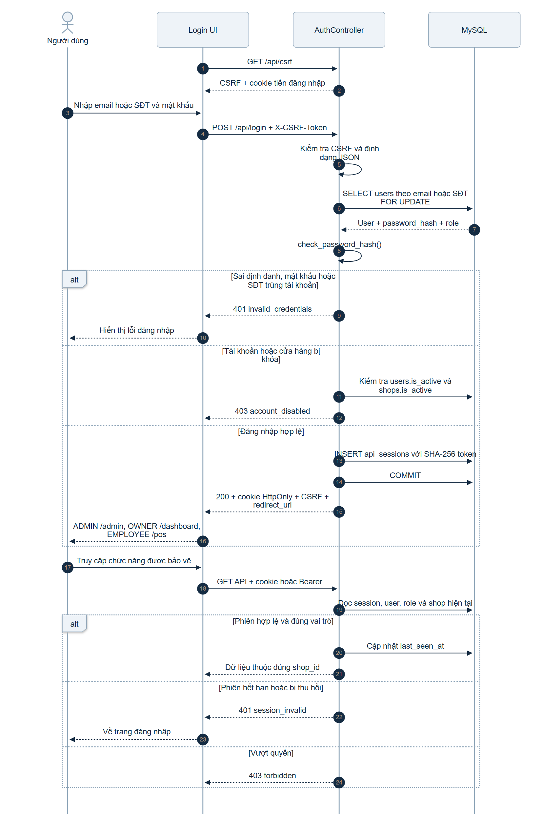
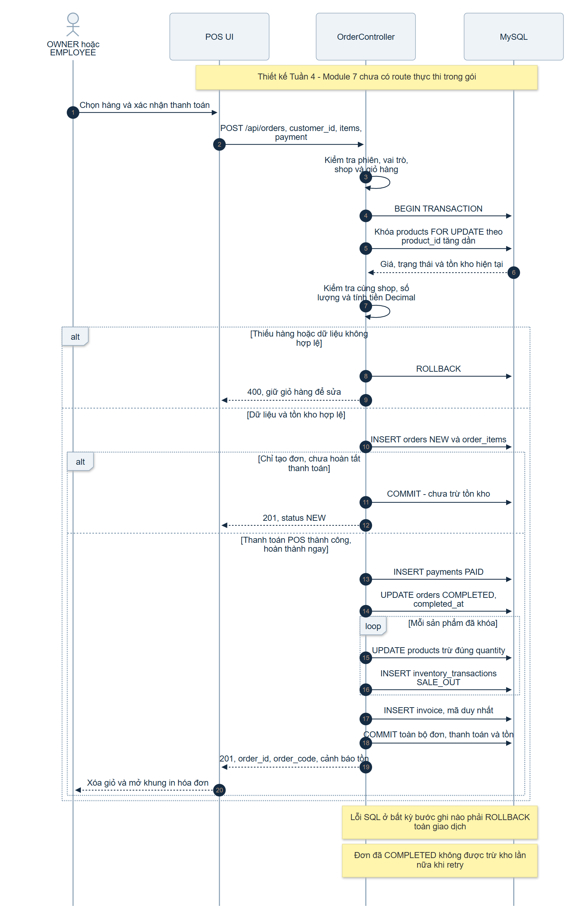
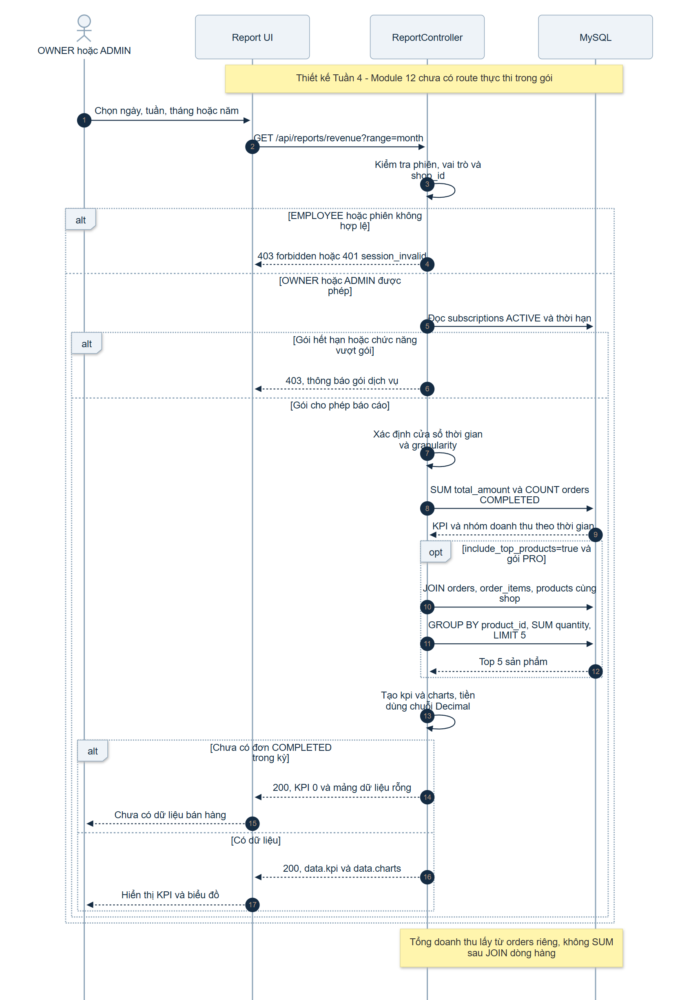

# Ba Sequence Diagram – Tuần 4, Thành viên A

Các sơ đồ dùng tên bảng/trường của từ điển dữ liệu mục 2.4.2 trong báo cáo. Mỗi sơ đồ có nguồn Mermaid để sửa, SVG để xuất bản và PNG để xem/đưa vào Word hoặc Slide. SVG giữ chữ rõ khi phóng to. Nguồn đã được parse và render bằng Mermaid 12.1.0.

## 1. Đăng nhập và xác thực

[Nguồn Mermaid](01-login-authentication.mmd) · [SVG](01-login-authentication.svg) · [PNG](01-login-authentication.png)

Luồng đã cài đặt: lấy CSRF, login bằng email/SĐT và mật khẩu, kiểm tra hash/trạng thái, ghi api_sessions, cấp cookie và redirect_url. Khi gọi route bảo vệ, server kiểm tra hạn phiên, vai trò và shop hiện tại. Thao tác ghi dùng cookie còn cần X-CSRF-Token. Logout thu hồi phiên; luồng đăng ký và logout được mô tả trong hợp đồng API.

## 2. Tạo đơn hàng và tự động trừ tồn

[Nguồn Mermaid](02-order-stock.mmd) · [SVG](02-order-stock.svg) · [PNG](02-order-stock.png)

Thiết kế cho Module 7: kiểm tra vai trò OWNER/EMPLOYEE, cùng shop, khách chưa xóa và giỏ hợp lệ; khóa các hàng sản phẩm theo product_id tăng dần để hạn chế deadlock. Backend tính giá/tổng bằng Decimal. Đơn NEW chưa trừ tồn; thanh toán POS thành công mới đổi COMPLETED, trừ stock_quantity và ghi SALE_OUT cùng transaction với payment/invoice. Bất kỳ lỗi ghi nào đều rollback; hoàn tất đơn đã COMPLETED không được trừ thêm. Tạo đơn chưa hoàn tất chỉ kiểm tra tồn hiện tại, không giữ chỗ; khi hoàn tất sau phải khóa và kiểm tra lại tồn.

Một request tạo đơn mới gửi lại có thể tạo đơn mới nếu chưa có khóa idempotency. Báo cáo chưa thiết kế trường/khóa này; người triển khai POS cần thống nhất cơ chế chống gửi lặp trước khi dùng thanh toán thực tế.

## 3. Thống kê doanh thu theo thời gian

[Nguồn Mermaid](03-revenue-time.mmd) · [SVG](03-revenue-time.svg) · [PNG](03-revenue-time.png)

Thiết kế cho Module 12: OWNER hoặc ADMIN theo mục 2.2.4; ADMIN phải chọn shop_id. Kiểm tra gói còn hiệu lực, chỉ lấy orders.COMPLETED, tính tổng/đếm trực tiếp từ orders để không nhân doanh thu do nhiều dòng/payment. Top sản phẩm dùng truy vấn riêng. Không có dữ liệu trả 200 với KPI 0 và mảng rỗng.

Quy tắc STANDARD có báo cáo cơ bản, PRO thêm Top 5 được thể hiện như **giả định thiết kế**, vì Word yêu cầu kiểm tra gói nhưng chưa chốt ma trận quyền từng biểu đồ. Mốc thời gian và nhóm báo cáo cũng được chốt tối thiểu trong [api-conventions.md](../api-conventions.md). Các lựa chọn này cần được nhóm thống nhất khi cài Module 12.

Hai sơ đồ cuối chưa có route thực thi trong gói. Đây là sản phẩm thiết kế Tuần 4, không phải minh chứng kiểm thử chức năng POS/báo cáo. Có thể sửa nguồn bằng công cụ hỗ trợ [Mermaid Sequence Diagram](https://mermaid.js.org/syntax/sequenceDiagram.html).
