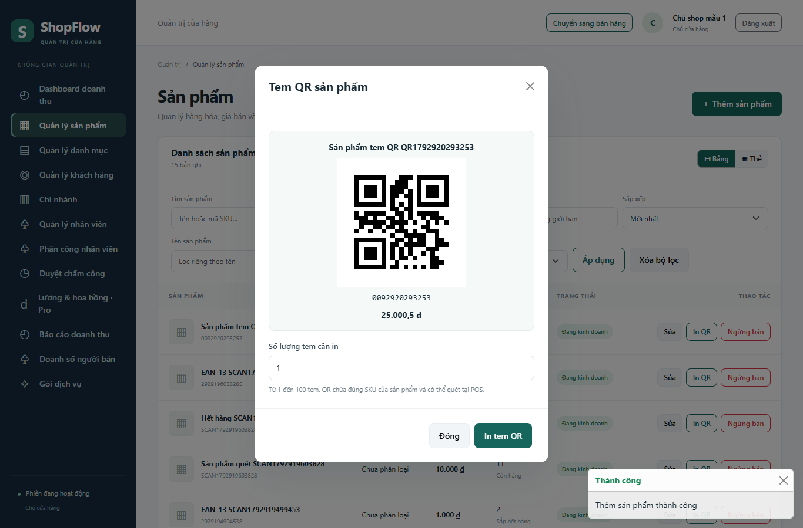
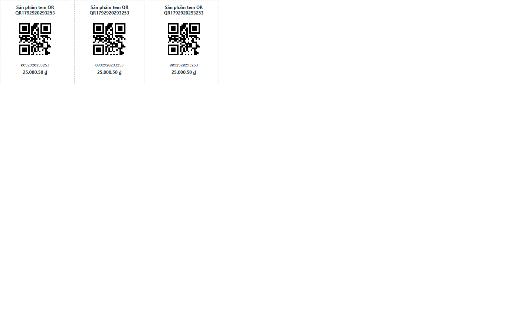

# Tem QR sản phẩm và kết nối POS

## Sử dụng

1. OWNER mở **Quản lý sản phẩm** và thêm sản phẩm như bình thường.
2. Sau khi lưu thành công, hộp thoại tem QR tự hiện với tên, mã SKU và giá bán.
3. Chọn từ 1 đến 100 tem, bấm **In tem QR**. Trang in mở ở tab mới và chỉ mở hộp thoại in sau khi ảnh QR đã sẵn sàng.
4. Chọn khổ A4, tỷ lệ 100% và tắt đầu/chân trang của trình duyệt nếu cần. Tem rộng 50 mm, QR rộng 32 mm, có khoảng trắng xung quanh để dễ đọc.
5. Có thể mở lại bằng nút **In QR** trong bảng hoặc thẻ sản phẩm, điều chỉnh số tem và in lại trên trang in.

Mã QR chứa nguyên văn `product_code`, gồm cả số 0 đầu mã. Quét tem tại POS sẽ thêm một sản phẩm; quét lại tăng số lượng. Nếu sửa SKU, cần in lại tem. Không dùng URL sản phẩm làm nội dung QR vì POS đối soát bằng SKU.

## Hành vi và phân quyền

- Sản phẩm được lưu trước khi hiện tem. Nếu tải QR bị lỗi, sản phẩm vẫn tồn tại và có thể mở lại **In QR** để thử lại.
- Sau khi sửa sản phẩm, hệ thống giữ luồng sửa hiện tại; nút in lại luôn lấy SKU mới nhất từ máy chủ.
- Chỉ OWNER được sử dụng API tem và trang in, trong phạm vi shop hiện tại. EMPLOYEE và ADMIN không có quyền in tem qua các URL này.
- Tạo tem không thay tồn kho, không tạo hóa đơn, không ghi ảnh xuống đĩa và không cần migration CSDL.
- QR là PNG tạo tại máy chủ bằng thư viện `qrcode` đã có trong dự án. Bản in nhúng ảnh để tên/SKU và QR cùng phản ánh một lần đọc dữ liệu.

## API

`GET /api/products/<product_id>/qr-label`

Trả `product_id`, `product_code`, `product_name`, `price`, `qr_data_url` và `print_url` trong envelope thành công hiện có. Không cache dữ liệu để tránh dùng tem cũ sau khi đổi SKU.

`GET /management/products/<product_id>/qr-label?copies=1&autoprint=false`

`copies` là số nguyên 1–100. `autoprint` dùng quy tắc boolean chung của API; mặc định không tự mở hộp thoại in. Nút in từ modal truyền `autoprint=true`. Trang in chờ ảnh hoàn tất rồi mới gọi chức năng in của trình duyệt; chỉ nội dung tem xuất hiện trên bản in.

## Kiểm thử

Kết quả lần chạy ngày 25/10/2026: **280 ca Python và 39 kịch bản trình duyệt đạt** (9 tem QR, 12 quét POS, 18 hồi quy CRUD). Xem [kết quả chi tiết](test-results/pos-qr-validation.json) và [JUnit Python](test-results/pytest-pos-qr.xml).

- Python: `python -m pytest -q`. Bổ sung 19 ca trong `tests/test_product_qr_labels.py`, kiểm tra PNG, bản in, số lượng, phiên đăng nhập, quyền shop, SKU mới và escape HTML.
- Trình duyệt: `npm run test:product-qr` chạy 9 kịch bản tạo sản phẩm → hiện tem → giải mã QR → mở bản in, in lại, đổi SKU, phục hồi lỗi và quét vào POS.
- Suite giao diện CRUD hiện có đã được cập nhật để kiểm tra và đóng modal QR sau khi tạo sản phẩm.
- Dùng CSDL thử nghiệm riêng theo README. Browser suite có tạo/sửa sản phẩm; không chạy trên dữ liệu vận hành.
- `window.print` được mô phỏng trong kiểm thử để tránh gửi lệnh tới máy in. QR được giải mã thật bằng ZXing; chưa xác nhận chất lượng in/quét trên máy in và thiết bị vật lý.

Các biến cấu hình: `E2E_BASE_URL`, `E2E_CHANNEL`, `E2E_OWNER_EMAIL`, `E2E_OWNER_PASSWORD`, `E2E_QR_REPORT`, `E2E_QR_PREVIEW`, `E2E_QR_PRINT`. Hai biến cuối lưu ảnh kiểm tra giao diện nếu được chỉ định.

## Ảnh kiểm tra

