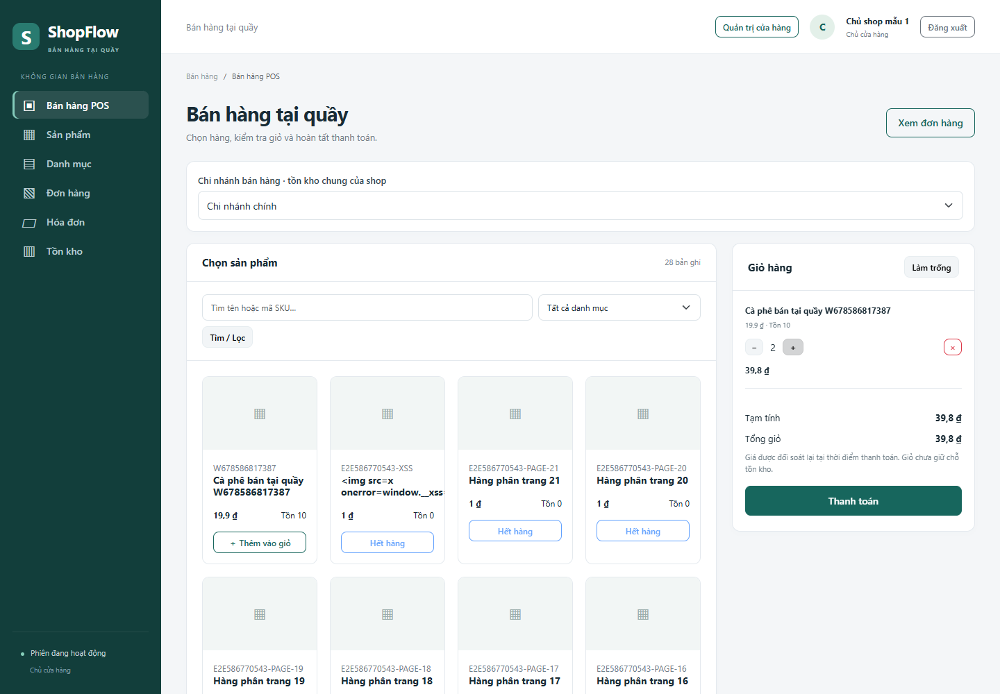
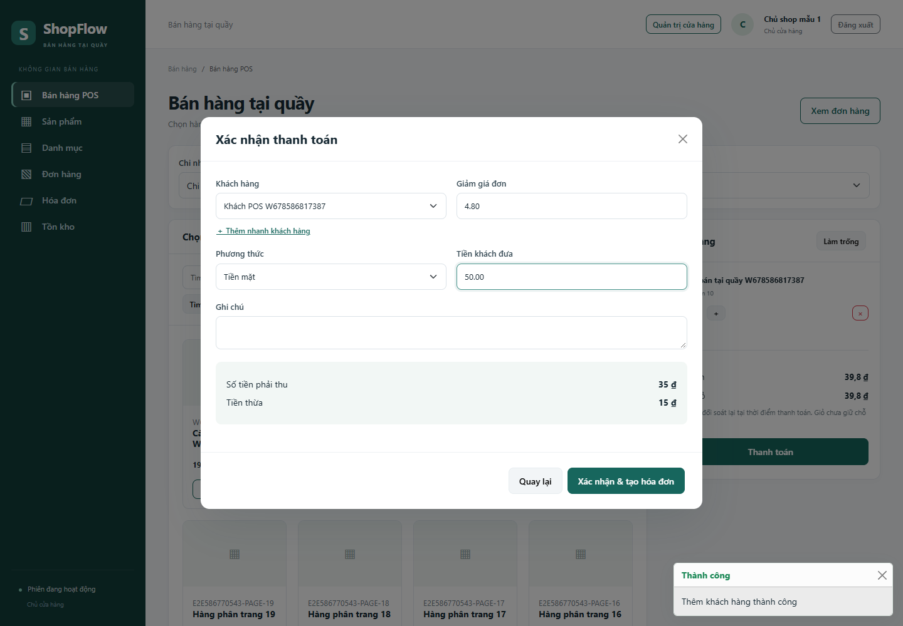
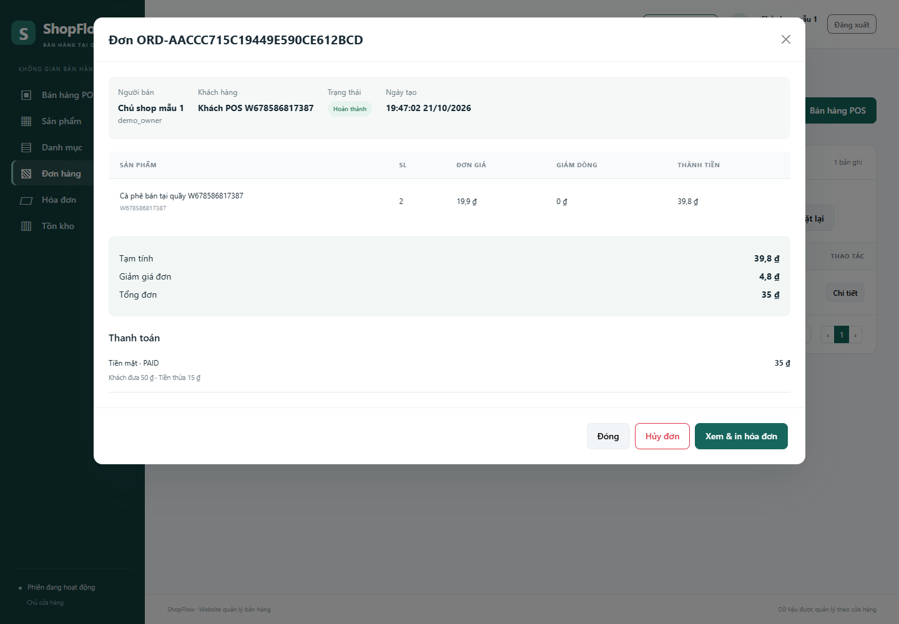
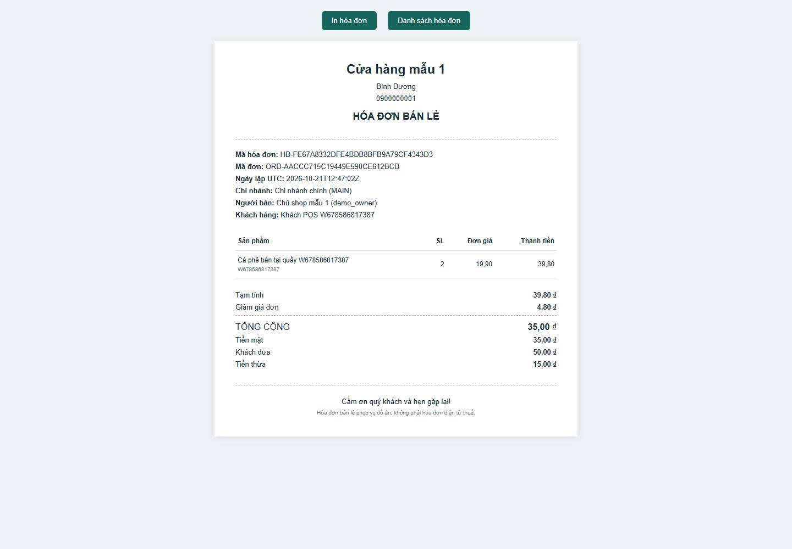
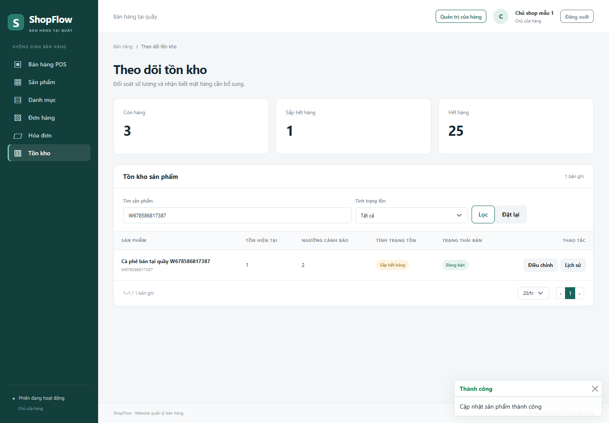
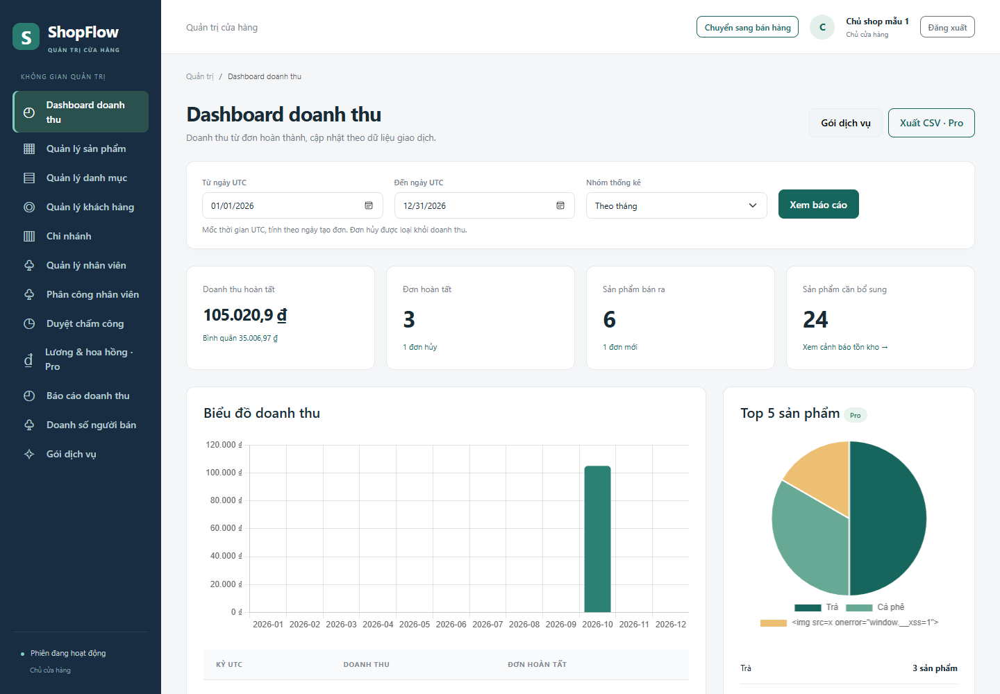
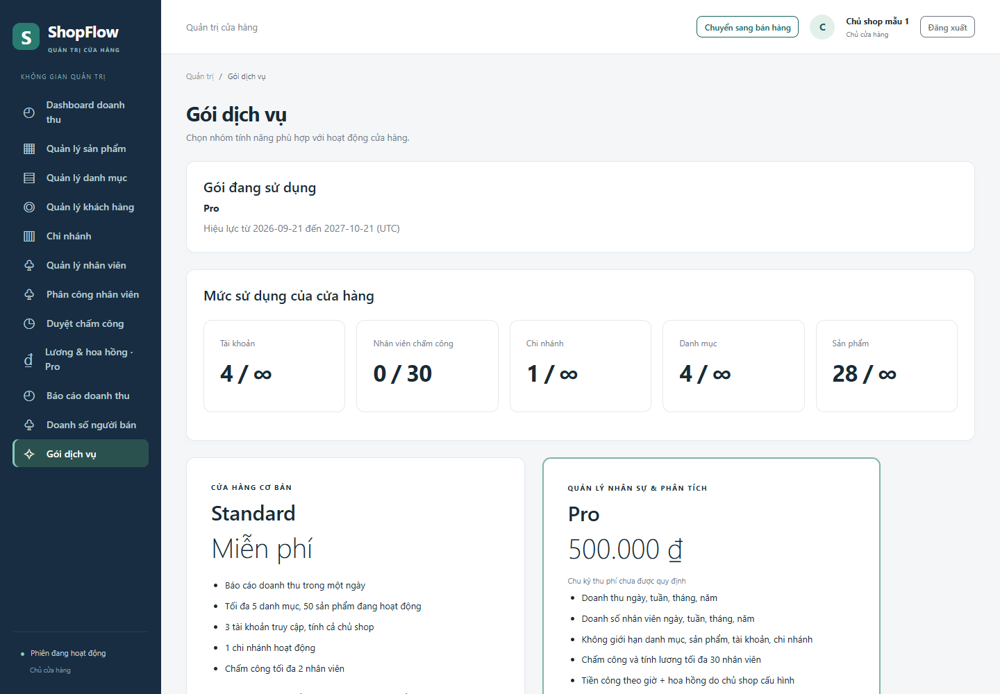

# Chương 3 Bổ sung hiện thực Tuần 6 7 và 8

Cập nhật ngày 15/10/2026, bổ sung cho bản Chương 3 Tuần 5–6 đã bàn giao ngày 09/10/2026. Kết quả hiện tại hoàn thiện phần backend và frontend của hai thành viên cho các module quản lý nền tảng, bán hàng và phân tích kinh doanh.

## 3.2.2 Quản lý sản phẩm và danh mục

Giữ Product/Category API đã triển khai: CRUD, phân trang, lọc tên/SKU/danh mục/giá, ảnh PNG/JPG/WEBP có kiểm tra nội dung và dung lượng. Giao diện có bảng/Card, modal thêm/sửa và preview. Danh mục không được xóa khi còn sản phẩm, kể cả sản phẩm ngừng kinh doanh. Giá, tồn và ngưỡng cho phép bằng 0 theo schema đã chốt.

## 3.2.3 Khách hàng và nhân viên

Customer tiếp tục CRUD, tìm kiếm, xóa mềm, khôi phục và lịch sử từ orders/order_items/payments. POS hỗ trợ thêm nhanh khách để sử dụng ngay trong thanh toán. Employee có hồ sơ và tài khoản liên kết, tạo tài khoản nguyên tử hoặc tạo sau, khóa/mở và thu hồi phiên. Hai trạng thái hồ sơ làm việc và tài khoản được tách trên giao diện. Bộ kiểm thử Tuần 6 được chạy lại trên bản mới.

## 3.2.4 POS đơn hàng thanh toán và hóa đơn

Giỏ hàng được lưu ở server theo phiên, tối đa 100 mặt hàng. Frontend gửi product_id/quantity; server lấy giá và đối soát tồn từ products. version xử lý thay đổi đồng thời ở nhiều tab, cart_id ràng buộc giỏ với phiên. Client tính tiền thừa bằng BigInt theo 1/100 đơn vị, server tính Decimal và ghi DECIMAL(15,2).

*Hình bổ sung 3.8 Giao diện POS bán hàng tại quầy.*

Modal thanh toán có khách lẻ/khách được chọn, thêm nhanh khách, giảm giá, tiền khách đưa và tiền thừa. Phương thức CASH hoặc BANK_TRANSFER mô phỏng. QR được tạo tại server và có nhãn mô phỏng; thu ngân xác nhận đối soát và nhập mã tham chiếu.

*Hình bổ sung 3.9 Modal thanh toán tiền mặt.*

POST checkout đối soát expected_total_amount, khóa sản phẩm và tạo orders/order_items/payments/invoices trong một transaction. Idempotency-Key, receipt và phiên giỏ bảo vệ khi gửi lại yêu cầu hoặc mất phản hồi. Nếu giá/tồn thay đổi, server báo lỗi và rollback; giao diện giữ form để kiểm tra lại. Đơn chờ NEW có thể chuyển PROCESSING và thanh toán để COMPLETED; chỉ chủ cửa hàng được hủy.

*Hình bổ sung 3.10 Chi tiết đơn, thanh toán và các hành động theo quyền.*

Hoàn tất ghi SALE_OUT và giảm products.stock_quantity. Hủy đơn đã hoàn tất ghi CANCEL_RETURN, hoàn đúng một lần, thanh toán được ghi nhận CANCELLED/refunded_at. Hóa đơn được giữ và có trạng thái đã hủy. Hóa đơn mới lưu snapshot shop/khách/thu ngân/dòng hàng/số tiền, nên sửa sản phẩm không thay đổi chứng từ đã phát hành. Trang in sử dụng CSS @media print, khổ A5 và lệnh window.print.

*Hình bổ sung 3.11 Mẫu hóa đơn có tiền khách đưa và tiền thừa.*

## 3.2.5 Tồn kho báo cáo và gói dịch vụ

Trang tồn kho hiển thị xanh khi stock_quantity > min_stock, vàng khi 0 < stock_quantity ≤ min_stock, đỏ khi bằng 0. Chủ cửa hàng có thể điều chỉnh số kiểm kê qua Product API; ADJUST_IN/ADJUST_OUT được ghi cùng transaction. Lịch sử cho biết số trước/sau, SALE_OUT, CANCEL_RETURN và ghi chú.

*Hình bổ sung 3.12 Cảnh báo tồn kho và điều chỉnh số lượng.*

Dashboard lấy dữ liệu thật từ SQL: doanh thu, số đơn hoàn tất/hủy/mới, số lượng bán và cảnh báo tồn. Doanh thu theo orders.created_at UTC và trạng thái COMPLETED, loại đơn hủy. SUM(total_amount) tách khỏi JOIN dòng hàng/thanh toán để không nhân đôi tiền. API hỗ trợ ngày/tuần/tháng/năm và điền 0 cho kỳ không có giao dịch. Chart.js vẽ cột doanh thu và biểu đồ tròn Top 5 theo số lượng bán.

*Hình bổ sung 3.13 Dashboard doanh thu và sản phẩm bán chạy.*

Subscription thực hiện ở server, đọc gói ACTIVE còn hạn. Standard có nghiệp vụ cửa hàng và báo cáo cơ bản; Pro thêm Top 5 và xuất CSV. Hết hạn quay về Standard, các endpoint nâng cao trả 403 plan_required. ADMIN chọn shop và cấp gói/thời hạn; OWNER không được tự cấp Pro. Báo cáo chưa quy định giá bán nên bảng Pricing mô tả tính năng, không giả lập giá hay tự thu phí.

*Hình bổ sung 3.14 Bảng tính năng và gói đang sử dụng.*

## 3.5 Kiểm thử và cấu trúc dữ liệu bổ sung

Schema giữ 13 bảng nghiệp vụ và api_sessions, thêm shopping_carts và operation_receipts. Các cột bổ sung phục vụ lý do hủy, tiền khách đưa/thừa và snapshot. CLI upgrade-week678 nhận diện các cột/bảng còn thiếu, chạy lại được và giữ dữ liệu cũ. Có kiểm thử nâng từ bản 14 bảng có seed lên 16 bảng, đối chiếu giá/tồn và in hóa đơn cũ.

Các trường hợp kiểm tra gồm CRUD Tuần 6, tính tiền lẻ, giá/tồn 0, ảnh giả/quá dung lượng, hai người bán món cuối, checkout cùng key đồng thời, hủy đồng thời, giá đổi trước thanh toán, giỏ khác phiên, mất phản hồi sau commit, phân quyền theo role/shop, Standard/Pro và hết hạn. Kết quả cuối được ghi ở [validation-week678.md](../docs/validation-week678.md) và các tệp JSON/JUnit tương ứng.

Phạm vi mô phỏng: QR/chuyển khoản và hủy thanh toán không gọi hệ thống ngân hàng; CSV mở bằng Excel nhưng không phải XLSX; hóa đơn bán lẻ phục vụ đồ án và chưa tích hợp hóa đơn điện tử thuế. Bản Word cũ được giữ để đối chiếu, phần bổ sung này phản ánh phiên bản triển khai Tuần 6–8.
